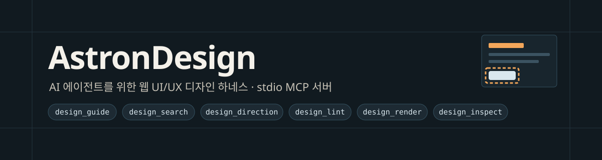
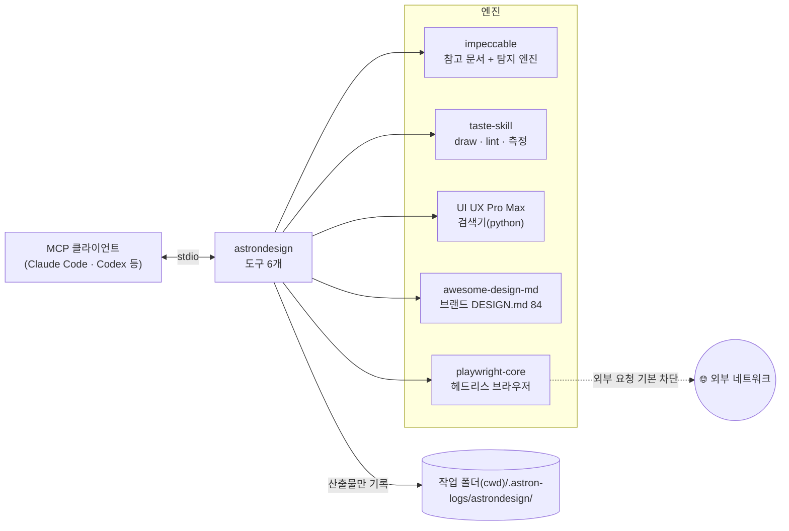
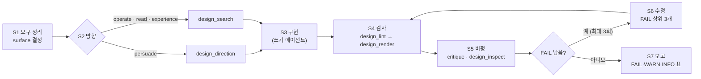
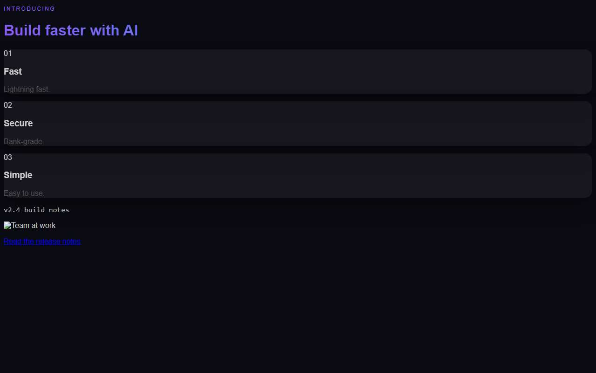
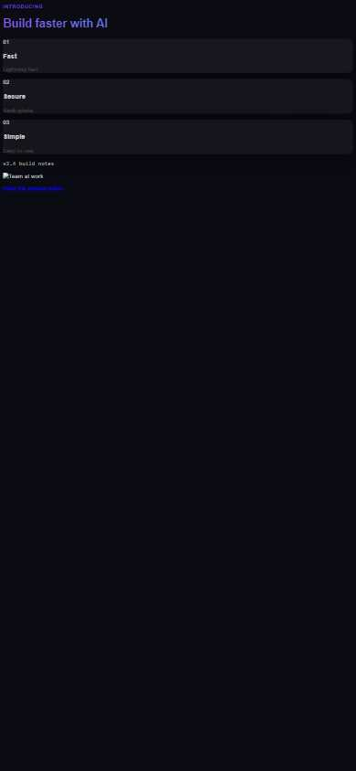
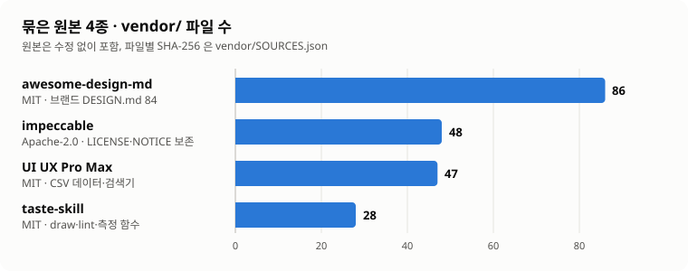

<p align="center">
	
</p>

<p align="center">
	=22.18" src="https://img.shields.io/badge/Node.js-%E2%89%A522.18-339933?logo=nodedotjs&logoColor=white">
	
	
	
	
</p>

<p align="center"><b>AI 에이전트가 웹 UI 를 만들 때 규칙·정적 검사·실제 렌더·요소 단위 피드백을 한 MCP 서버로 쓰게 하는 디자인 하네스</b></p>

| 🧭 흐름과 우선순위 | 🔍 결정적 정적 검사 | 🖥️ 실제 브라우저 렌더 | 🎯 요소 단위 피드백 |
|---|---|---|---|
| 작업 흐름 S1~S7 과 충돌 우선순위 P0~P7 을 코드와 문서에 같은 내용으로 고정합니다 | impeccable 엔진과 taste lint 로 소스를 검사하고 우선순위를 적용해 FAIL·WARN·INFO 로 냅니다 | 헤드리스 브라우저로 여러 폭을 렌더해 첫 화면 스크린샷·측정 규칙·접근성 스냅샷을 남깁니다 | 선택자·좌표로 요소 묶음(HTML·계산 스타일 16개·위치)을 모아 Design Feedback 을 씁니다 |

## 목차
- [구조](#구조)
- [작업 흐름](#작업-흐름)
- [충돌 우선순위](#충돌-우선순위)
- [렌더 예시](#렌더-예시)
- [묶은 원본](#묶은-원본)
- [빠른 시작](#빠른-시작)
- [제공 도구](#제공-도구)
- [설정](#설정)
- [운영 안내](#운영-안내)
- [출처·라이선스](#출처라이선스)

## 구조



- 하네스는 프로젝트 파일을 쓰지 않습니다. 고치는 일은 에이전트가 직접 하고, 하네스는 읽기·검사·렌더 결과만 냅니다.
- 원본 4종은 `vendor/` 에 수정 없이 들어 있습니다. 문서 안의 실행 지시(`node draw.mjs`, `python search.py` 등)는 이 도구들로 대체합니다(`guides/precedence.md` 대체표).

## 작업 흐름

`design_guide` 를 topic 없이 부르면 시작 안내가 나오고, 흐름 전문은 [guides/workflow.md](guides/workflow.md) 에 있습니다.



| surface | 대상 | 적용 규칙 |
|---|---|---|
| persuade | 공개 랜딩·마케팅 페이지 | impeccable + taste + UI UX Pro Max |
| operate | 대시보드·앱 화면 | impeccable + UI UX Pro Max |
| read | 문서·글 읽기 화면 | impeccable + UI UX Pro Max |
| experience | 몰입형·인터랙티브 화면 | impeccable + UI UX Pro Max |

읽기 전용 에이전트(진단·검토·QA)는 S1·S2·S4·S5·S7 만, 쓰기 에이전트는 전 단계를 합니다.

## 충돌 우선순위

원본 4종의 규칙이 부딪히면 위 순위가 이깁니다. `src/precedence.ts`(코드)와 [guides/precedence.md](guides/precedence.md)(문서)는 같은 규칙입니다. 세부 해소표 C1~C12 는 문서에 있습니다.

| 순위 | 원천 |
|---|---|
| P0 | 노드·그래프 지시(출력 형식, 노드 정책) |
| P1 | 사용자·브리프의 명시 요구(도구 인자 `allow`) |
| P2 | 프로젝트 기존 디자인 시스템: DESIGN.md 토큰, 그다음 기존 코드 토큰 |
| P3 | 접근성·품질 하한: 대비 4.5:1, 가림·잘림·깨진 이미지·스크립트 오류·제목 순서·작은 글자 |
| P4 | impeccable craft-floor·모드 규칙(모든 surface, "defaults, not bans") |
| P5 | taste 하우스 규칙(persuade 에서만, 그 범위 안에서는 금지) |
| P6 | UI UX Pro Max 검색 결과(권고) |
| P7 | 브랜드 참고 DESIGN.md(awesome-design-md) |

> [!IMPORTANT]
> P3 하한은 P1·P2 의 `allow` 로도 낮추지 않습니다. 대신 `conflict: true` 와 "사람 결정 필요"를 붙입니다. 하네스는 접근성 결정을 대신하지 않습니다.

## 렌더 예시

시험용 페이지 `test/fixtures/persuade/index.html` 을 `design_render`(surface `persuade`, 폭 1280·390)로 렌더한 결과입니다. 일부러 흔한 결함을 넣은 페이지입니다.

<table>
	<tr>
		<td width="72%"></td>
		<td width="28%"></td>
	</tr>
	<tr>
		<td align="center">폭 1280</td>
		<td align="center">폭 390</td>
	</tr>
</table>

```text
FAIL design_render: FAIL 10 · WARN 6 · INFO 3 (allowed 0, surface-skipped 0)
외부 자원 1건 차단: 실제 화면과 다를 수 있음
[FAIL] contrast (taste-gate, impeccable) — Unreadable text: "Read the release notes" 2.1:1 (#0000ee on #0b0b14)
[FAIL] gradient-text (taste-gate, impeccable) — 1 gradient-filled text element(s).
[FAIL] skipped-heading (impeccable) — Skipped heading level: <h1> "Build faster with AI" followed by <h3> "Fast" (missing h2)
[WARN] flat-type-hierarchy (impeccable) — Role sizes: body 16px, h1 16px, h3 16px (largest adjacent step 1.00:1; target 1.25:1)
[INFO] broken-image (taste-gate) — Broken image(s): https://example.invalid/a.png [blocked-by-harness]
```

| 결과 | 건수 | 대표 발견 |
|---|---|---|
| 🔴 FAIL | 10 | 대비 2.1:1, 그라디언트 글자, 제목 단계 건너뜀, 보라 팔레트, 장식 번호, 정지 화면 |
| 🟡 WARN | 6 | 기본 서체 Inter, 평평한 글자 위계, 첫 화면 버튼 없음, 글래스 면 |
| 🔵 INFO | 3 | 외부 이미지 차단으로 생긴 발견(`blocked-by-harness`, 결함으로 세지 않음) |

- 같은 문제를 두 엔진이 잡으면 하나로 합치고 출처를 모두 적습니다(`contrast (taste-gate, impeccable)`).
- 전체 결과는 호출 폴더의 `report.json` 에, 스크린샷은 같은 폴더의 `fold-<폭>.jpg` 에 남습니다.

## 묶은 원본

<p align="center">
	
</p>

| 원본 | 라이선스 | 쓰임 | 파일 |
|---|---|---|---|
| [impeccable](https://github.com/pbakaus/impeccable) | Apache-2.0 | 참고 문서(craft-floor·모드 등) + 결정적 탐지 엔진 0.1.15 | 48 |
| [taste-skill](https://github.com/Leonxlnx/taste-skill) | MIT | 아트 디렉션 draw, lint, 렌더 측정 함수 | 28 |
| [UI UX Pro Max](https://github.com/nextlevelbuilder/ui-ux-pro-max-skill) | MIT | 스타일·색·서체 CSV 와 검색기·디자인 시스템 제안 | 47 |
| [awesome-design-md](https://github.com/VoltAgent/awesome-design-md) | MIT | 브랜드 DESIGN.md 84개(참고 전용) | 86 |

원본 커밋과 파일별 SHA-256 은 [vendor/SOURCES.json](vendor/SOURCES.json) 에 있습니다.

## 빠른 시작

**요구 사항**

| 항목 | 버전 | 쓰임 |
|---|---|---|
| Windows | x64 | impeccable 엔진 바이너리(`@impeccable/cli-windows-x64`) |
| Node.js | 22.18 이상(24 권장) | `.ts` 를 빌드 없이 직접 실행 |
| Python | 3.9 이상 | design_search(UI UX Pro Max 검색기) |
| 브라우저 | chromium headless shell 또는 Edge | design_render·design_inspect |

**설치와 확인**

```powershell
git clone <저장소 주소> <설치 경로>
cd <설치 경로>
npm ci            # 저장소 안에만 설치(.npmrc: save-exact, ignore-scripts)
npm run smoke     # initialize → tools/list → design_guide, 마지막 줄 OK
```

**클라이언트 등록**

```powershell
# Claude Code
claude mcp add astrondesign --scope user -e ASTRONDESIGN_NETWORK=off -- node "<설치 경로>/src/server.ts"
```

```toml
# Codex: ~/.codex/config.toml
[mcp_servers.astrondesign]
command = "node"
args = ["<설치 경로>/src/server.ts"]
tool_timeout_sec = 180
```

`.mcp.json` 예시, 제한 시간 근거, 문제 해결은 [docs/integration.md](docs/integration.md) 에 있습니다.

## 제공 도구

| 도구 | 하는 일 | 주요 입력 |
|---|---|---|
| `design_guide` | 작업 흐름·우선순위·비평 규약과 원본 참고 문서를 3,500자 쪽 단위로 제공. 먼저 topic 없이 부름 | `topic`(예: `workflow`, `impeccable/craft-floor`, `brand/vercel`), `offset` |
| `design_search` | UI UX Pro Max 검색·디자인 시스템 제안(권고, P6) | `query`, `domain`, `stack`, `design_system`, `max_results` |
| `design_direction` | 공개 랜딩·마케팅 페이지의 아트 디렉션 뽑기(taste draw, 오프라인) | `sector`, `brief`, `sections`, `tone`, `have`, `keep`, `options`, `seed` |
| `design_lint` | 소스 정적 검사(impeccable + taste lint) 후 P0~P7·C1~C12 적용 | `paths`, `surface`, `allow`, `design_md`, `engines` |
| `design_render` | 헤드리스 브라우저로 여러 폭 렌더: 첫 화면 스크린샷, taste 측정, impeccable DOM 검사, 접근성 스냅샷 | `target`, `surface`, `widths`(최대 4), `checks`, `allow`, `wait_ms` |
| `design_inspect` | 선택자·좌표로 요소 묶음(HTML·계산 스타일 16개·위치·잘린 이미지)을 모으고 `notes` 로 Design Feedback 작성 | `target`, `selector` 또는 `point`, `notes`, `width`, `height` |

결과 첫 줄은 `OK|FAIL|ERROR <요약>` 이고, 발견 줄은 `[LEVEL] id (sources) 위치 — message [overridden_by]` 형식입니다.

## 설정

| 환경 변수 | 기본 | 뜻 |
|---|---|---|
| `ASTRONDESIGN_OUT_DIR` | `<cwd>/.astron-logs/astrondesign` | 산출 루트(절대 경로) |
| `ASTRONDESIGN_NETWORK` | `off` | `allow` 이고 호출 인자 `allow_network:true` 일 때만 외부 요청 허용 |
| `ASTRONDESIGN_PYTHON` | `python` | UI UX Pro Max 검색에 쓸 python |
| `ASTRONDESIGN_BROWSER` | — | 브라우저 실행 파일(1순위) |
| `ASTRONDESIGN_IDLE_MS` | `120000` | 마지막 호출 뒤 브라우저를 닫기까지의 시간(ms) |

## 운영 안내

<details>
<summary>📁 산출물과 프로젝트 무쓰기</summary>

- 모든 산출(스크린샷·`report.json`·Design Feedback)은 `<cwd>/.astron-logs/astrondesign/<시각>-<도구>-<id>/` 에 남습니다.
- 프로젝트 파일은 쓰지 않습니다. 브랜드 DESIGN.md 를 프로젝트에 복사하는 일도 사용자가 명시적으로 요청할 때만 에이전트가 직접 합니다.
- 렌더·검사 대상은 서버 cwd 안의 경로여야 합니다.

</details>

<details>
<summary>🌐 네트워크 차단</summary>

- 기본으로 외부 요청을 막습니다. 로컬 파일은 루프백 정적 서버로 띄워 렌더합니다.
- 하위 프로세스에는 텔레메트리 끄기와 프록시 차단을 적용합니다.
- 외부 URL 을 렌더하려면 env `ASTRONDESIGN_NETWORK=allow` 와 인자 `allow_network:true` 가 모두 필요합니다.
- 차단 때문에 생긴 발견은 `blocked-by-harness` 로 표시되고 결함으로 세지 않습니다.

</details>

<details>
<summary>🖥️ 브라우저 수명과 동시 실행</summary>

- 브라우저는 첫 렌더 때 띄우고(env 경로 → playwright 기본 → Edge), 마지막 호출 뒤 `ASTRONDESIGN_IDLE_MS` 가 지나면 닫습니다.
- 서버 하나가 브라우저 하나를 씁니다. 동시에 도는 디자인 에이전트는 2개 이하를 권장합니다.

</details>

<details>
<summary>🧪 시험 명령</summary>

```powershell
npm run typecheck     # tsc 오류 0
npm test              # 단위 + MCP 프로토콜 + 엔진 시험
npm run smoke         # 서버 기동 확인
npm run test:browser  # 실제 브라우저 시험(무거움)
npm run vendor        # 원본 사본에서 vendor/ 재생성(커밋 해시 확인)
```

</details>

## 출처·라이선스

- 원본 4종의 저장소·커밋·포함/제외 범위·파생 파일은 [NOTICE.md](NOTICE.md), 파일별 해시는 [vendor/SOURCES.json](vendor/SOURCES.json) 에 있습니다.
- impeccable 의 LICENSE·NOTICE.md 는 `vendor/impeccable` 에 그대로 보존합니다.
- `design_inspect` 의 요소 묶음 형식은 stablyai/orca Design Mode(MIT)의 동작을 참고해 새로 구현했습니다(코드 미포함).
- 브랜드 DESIGN.md 는 참고 자료입니다. 각 상표·외형의 권리는 해당 소유자에게 있습니다.
- 이 저장소 자체의 라이선스는 아직 정하지 않았습니다(`package.json` 의 `UNLICENSED`).
